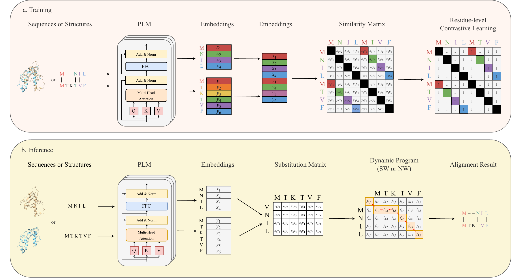

CLAlign
=======

CLAlign aligns protein sequences or protein structures with residue-level
embeddings from protein language models.



Overview
--------

CLAlign learns residue-level representations for protein alignment through
contrastive learning. During training, sequence or structure inputs are encoded
by a protein language model, and aligned residue pairs are pulled together while
non-matching residues are separated in the residue-level similarity matrix. At
inference time, CLAlign embeds the query and reference proteins, builds a
substitution matrix from embedding similarities, and applies dynamic programming
for global or local alignment.

Installation
------------

CLAlign currently targets Python 3.12.7+ and CUDA 12.8 builds of PyTorch.
CLAlign was tested on Ubuntu 24.04 with an NVIDIA RTX 4090 GPU.
On first use, the ProtT5 base model is downloaded automatically from Hugging
Face if it is not already cached.

Clone the repository and install from the repository root with:

```bash
git clone https://github.com/yourh/CLAlign.git
cd CLAlign

conda create -n CLAlign python=3.12 -y
conda activate CLAlign

pip install . \
  --extra-index-url https://download.pytorch.org/whl/cu128 \
  --extra-index-url https://urob.github.io/numpy-mkl \
  -f https://data.pyg.org/whl/torch-2.7.1+cu128.html
```

The package includes the default LoRA adapters for:

- `CLAlign-ProtT5`
- `CLAlign-ProstT5`
- `CLAlign-ESMIF`

Pairwise Alignment
------------------

For a quick pairwise alignment, create a text file containing two protein
sequences, one per line. This example uses the MALISAM pair
`d1cs1a_d1q8ia1`:

```text
AGAVLTNTGMSAIHLVTTVFLDLVLHSCTKYLNGHSDVVAGVVIAKDPDVVTELAWWANNIGVTG
QESVAFIPADQVPRAQHILQGEQGFRLTPLALKDFHRQPVYGLYCRAHRQLMNYEKRLREGGVTVYEADVR
```

Then run:

```bash
clalign align pair pair.txt
```

The pairwise demo can also be run on CPU:

```bash
clalign --device cpu align pair pair.txt
```

GPU acceleration is recommended for larger workloads.

Example output:

```text
Alignment Score: 0.282163
AGA-V-L-TNT-GMSAIHLVTTVFLDLVLHSCTKYLNGHSDVVAGVVIAKDPDVVTELAWWANNIGVT------G
 || | | ||| |||||||||||||||||| |||| | ||||||||||||||||||||||||||||||      |
-QESVAFIPADQVPRAQHILQGEQGFRLTP-LALK-D-FHRQPVYGLYCRAHRQLMNYEKRLREGGVTVYEADVR
```

Batch Alignment
---------------

Align query proteins against reference proteins:

```bash
MKL_NUM_THREADS=1 clalign align query query.fasta reference.fasta results.csv
```

The output is a CSV file with query ID, reference ID, aligned strings, start
positions, and alignment score. By default, CLAlign reports hits with at least
20% query coverage. Change this cutoff with `--threshold`.

For local alignment:

```bash
MKL_NUM_THREADS=1 clalign align query query.fasta reference.fasta results.csv --local
```

For large searches, generate embeddings once and reuse them:

```bash
clalign generate-embs query.fasta query.clalign
clalign generate-embs reference.fasta reference.clalign

MKL_NUM_THREADS=1 clalign --use-precomputed align query \
  query.fasta reference.fasta results.csv \
  --qe query.clalign \
  --re reference.clalign
```

If an embedding path without `.npy` is provided, CLAlign will also try the same
path with `.npy` appended.

Remote Homology Search
----------------------

CLAlign can be used as an embedding-based remote homology search tool by
aligning a query FASTA against a reference database FASTA:

```bash
MKL_NUM_THREADS=1 clalign align query query.fasta reference.fasta homology_hits.csv \
  --only-score \
  --threshold 0.2 \
  --keep 100
```

`--keep` controls how many top reference hits are retained per query. Values
between 0 and 1 are interpreted as a fraction of the reference set; values
greater than or equal to 1 are interpreted as an absolute hit count.

Options
-------

By default, CLAlign loads the bundled `CLAlign-ProtT5` LoRA adapter on top of
`Rostlab/prot_t5_xl_uniref50`.

To use the ProstT5 adapter for sequence alignment:

```bash
MKL_NUM_THREADS=1 clalign \
  --base-model-name Rostlab/ProstT5 \
  --model-path CLAlign-ProstT5 \
  align query query.fasta reference.fasta prostt5_results.csv
```

To use the ESM-IF adapter for structure alignment, provide text files listing
PDB IDs and point `--pdb-dir` to the directory containing the corresponding
PDB files. Each line in the input list should match a file name without the
suffix, for example `1abc_A` for `pdbs/1abc_A.pdb`.

```bash
MKL_NUM_THREADS=1 clalign \
  --base-model-name esm_if1_gvp4_t16_142M_UR50 \
  --model-path CLAlign-ESMIF \
  --pdb-dir pdbs \
  align query query_pdbs.txt reference_pdbs.txt esmif_results.csv
```

Common options:

```bash
clalign --help
clalign align query --help
```

Useful flags include:

- `--model-path`: path to a LoRA adapter or model directory
- `--lora/--no-lora`: enable or disable LoRA loading
- `--base-model-name`: base protein language model
- `--max-length`: maximum model input length
- `--batch-size`: embedding batch size
- `--device`: device such as `cuda` or `cpu`
- `--amp`: enable autocast mixed precision
- `--pdb-dir`: read structure inputs from PDB files listed by name
- `--local`: use local alignment
- `--only-score`: skip storing alignment strings
- `--threshold`: minimum query coverage for reported hits
- `--use-precomputed`: require `--qe`/`--re` embeddings instead of loading a model

Manuscript Figures
------------------

See [figures/README.md](figures/README.md) for plotting scripts, frozen results,
and generated PDF figures. Run the scripts directly from this repository;
plotting does not run baselines or load protein models.

License
-------

CLAlign is released under the MIT License. This repository includes vendored
ESM 2.0.1 source code under `src/esm/`, distributed under its original MIT
License. See [`THIRD_PARTY_NOTICES.md`](THIRD_PARTY_NOTICES.md) for details.
